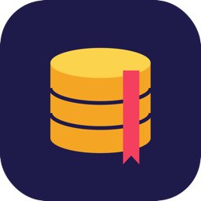

<p align="center">
  
</p>

<h1 align="center">Querybook</h1>

<p align="center">
  A fast, modern SQLite and SQLCipher browser for macOS and Windows. Open as many databases as you like, each in its own window.
</p>

<p align="center">
  <a href="https://github.com/KevalKThumar/Querybook/releases/latest"><b>Download for macOS</b></a> ·
  <a href="#features">Features</a> ·
  <a href="#keyboard-shortcuts">Shortcuts</a> ·
  <a href="#build-from-source">Build from source</a>
</p>

---

Querybook is an open-source desktop app for exploring and editing SQLite databases,
including SQLCipher 4 encrypted ones. It covers the everyday DB Browser for SQLite
workflow (browse, edit, run SQL, change the schema, import and export) with a
cleaner interface, and every database opens in its own window.

It's built with [Tauri 2](https://tauri.app) and [Leptos](https://leptos.dev) and is
written entirely in Rust. The UI is compiled to WebAssembly. The app makes no network
requests: your data never leaves your computer.

## Features

**Databases and windows**
- One database per window, with as many open at once as you like. Opening a file that is already open brings its window to the front.
- Open and create databases, with recent files on the welcome screen.
- Opens `.db`, `.db3`, `.sqlite`, `.sqlite3` and `.sqlcipher` files from Finder or File Explorer (double-click or **Open With**). On Windows, a file opened while Querybook is running goes to the running app.
- Light, dark and system themes.

**Encryption (SQLCipher 4)**
- Opens encrypted databases with a passphrase or a raw key (64 or 96 hex characters).
- Can create an encrypted database, encrypt an existing one, change its key, or remove encryption.
- Uses SQLCipher 4 default settings only: page size 4096, KDF 256,000 iterations, HMAC and KDF SHA512, plaintext header 0. These are the defaults DB Browser for SQLite and the `sqlcipher` CLI use.

**Browse and edit**
- Virtual-scrolling grid that stays smooth on tables with hundreds of thousands of rows.
- Sort by any column and filter per column. Plain text matches "contains"; you can also use `=`, `<>`, `>`, `<`, `>=` and `<=`.
- Edit cells inline, set NULL, insert, duplicate and delete rows.
- **Write Changes / Revert Changes**: nothing is saved automatically. Every change (grid edits, schema changes, imports, and statements you run in the SQL editor or from a `.sql` script) is held in a savepoint until you write it (⌘S, or Ctrl+S on Windows) or revert it. Closing a window with unwritten changes asks whether to **Save**, **Don't Save** or **Cancel**.
- Select single cells, cell ranges or whole rows (via the row numbers), as in a spreadsheet.
- Copy, Copy with headers, or Copy as SQL `INSERT` statements.
- Resize columns by dragging a header edge; double-click the edge to fit the contents.
- **Adjust rows to contents** grows each row to show its wrapped text.
- **Foreign keys**: follow a value to the row it references in the parent table.
- **Cell inspector**: view the full text, pretty-printed JSON, or a hex dump of BLOBs (the first 64 KiB), and edit the value there.

**SQL editor**
- Syntax highlighting and autocomplete for tables, columns (including `alias.`), functions and keywords.
- Run the statement under the cursor (⇧↵ or ⌘↵), the selection, or everything. Stop a long-running query.
- **Explain** shows `EXPLAIN QUERY PLAN` for the statement.
- **Format** (⇧⌥F) lays out SQL: uppercase keywords, one clause per line. Only whitespace and keyword case change, never the meaning.
- **Snippets**: save and reuse SQL across all your databases.
- Query history per database. Results appear in the same grid, with the inspector.

**Schema**
- Structure view for each table or view: columns, indexes and the `CREATE` statement.
- Create tables (primary key, autoincrement, NOT NULL, UNIQUE, defaults, `WITHOUT ROWID`) with a live SQL preview.
- Rename tables; add, rename and drop columns; create and drop indexes; drop any object.

**Import and export**
- Import CSV or TSV into a new or existing table, with a preview and a choice of separator.
- Run a `.sql` script. If it has its own `BEGIN … COMMIT`, that joins the pending changes as well, so the script is only saved when you write the changes.
- Export a table to CSV.
- Export tables and views as SQL: tick one, several or all of them (the **SQL** button on a table's Browse tab ticks just that table). For each table the script can drop it and create it again (or keep it with `CREATE … IF NOT EXISTS`) and insert the rows it has now. You can also export the schema only or the data only (optionally deleting the existing rows first), include indexes and triggers, write column names in each INSERT, put several rows in one INSERT, and wrap everything in a transaction.

**Database tab**
- File size, free space, page size, encoding, journal mode, auto-vacuum, user version, application ID, object counts, and the SQLite and SQLCipher versions.
- One-click **Integrity check**, **Quick check**, **Foreign key check**, **Optimize** and **VACUUM**.
- Turn foreign-key enforcement on or off.

**Change history**
- The **History** tab lists the last 3 saves made to the database, newest first. Each save shows when it was made, the tables, views, indexes and triggers it created, changed or dropped (with their SQL), and the rows it inserted, updated and deleted, with old and new values (an update shows only the columns that changed).
- Every save is recorded, whether it came from Write Changes (⌘S / Ctrl+S), **Save** when closing, or a `COMMIT` in the SQL editor. Reverted changes, and edits that end up where they started, aren't listed.
- The history stays on this computer, in Querybook's app data folder, and never goes into the database file. Each database has its own, and it's kept until you **Clear history**. It belongs to the file's path, so a moved or renamed database starts a new one.
- For an encrypted database the history is encrypted with that database's key, and changes when the key does. Only someone who can open the database can read it.
- Up to 1,000 rows of each save are kept with their values; past that, rows are only counted. Long text is cut at 200 characters, and BLOBs are shown by size.

## Install

### macOS

1. Download the latest `Querybook_x.y.z_aarch64.dmg` from **[Releases](https://github.com/KevalKThumar/Querybook/releases/latest)**. A zipped `Querybook.app` is there too.
2. Open the `.dmg` and drag **Querybook** into **Applications**.
3. **First launch.** Querybook is open source and not notarized by Apple, so macOS blocks it the first time. Either:
   - Try to open it, then go to **System Settings → Privacy & Security** and click **Open Anyway**; or
   - Run this once in Terminal:
     ```sh
     xattr -dr com.apple.quarantine /Applications/Querybook.app
     ```

Requirements: a Mac with **Apple Silicon** (M1 or later). Intel Macs are not supported by the release builds yet, but you can build from source.

### Windows

There's no prebuilt Windows release yet. [Build the installer from source](#build-from-source),
then run `Querybook_<version>_x64-setup.exe`. It installs for the current user (no admin
rights needed) and registers the SQLite file types.

The installer isn't code-signed, so SmartScreen may say "Windows protected your PC".
Click **More info**, then **Run anyway**.

Requirements: Windows 10 or 11 (x64). WebView2 is already part of both.

### Make Querybook the default for SQLite files

**macOS:** in Finder, select any `.sqlite` (or `.db`) file, press **⌘I**, choose **Querybook** under
**Open with**, then click **Change All…**. Each file extension is set separately.

**Windows:** right-click a `.sqlite` (or `.db`) file, choose **Open with → Choose another app**,
pick **Querybook** and click **Always**. Each file extension is set separately.

## Keyboard shortcuts

On macOS, Ctrl works wherever ⌘ is listed. On Windows, use Ctrl for ⌘, Alt for ⌥ and Shift for ⇧. The app's own hints and menus show the Windows names.

| Where | Shortcut | Action |
|---|---|---|
| Window | ⌘O / ⌘N | Open / new database |
| | ⌘T | New SQL tab |
| | ⌘S | Write changes (when there are any) |
| | Esc | Close a dialog or menu |
| Grid | Arrows, ⇧ + arrows | Move, extend a cell range |
| | ⌘↑ / ⌘↓, Home / End, PageUp / PageDown | First / last row, first / last column, page |
| | ↵ or F2 (or double-click) | Edit cell. ↵ saves, Esc cancels |
| | ⌫ | Set the selected cells to NULL, or delete the selected rows |
| | ⌘C / ⇧⌘C | Copy / copy with headers |
| | ⌘A | Select all rows |
| Inspector | ⌘↵ | Apply the edited value |
| SQL editor | ⇧↵ or ⌘↵ | Run the statement under the cursor, or the selection |
| | ⇧⌥F | Format SQL |
| | ⌃Space | Show suggestions (↑↓ to choose, ↵ or Tab to accept) |
| | Tab | Insert indent |

## Build from source

Prerequisites:

- **macOS:** the Xcode Command Line Tools.
- **Windows 10/11:** Visual Studio 2022 (Community or Build Tools) with the
  **Desktop development with C++** workload, and [Strawberry Perl](https://strawberryperl.com)
  (`winget install StrawberryPerl.StrawberryPerl`). SQLCipher uses OpenSSL on Windows, and
  OpenSSL's build needs a native Windows Perl; the Perl bundled with Git doesn't work. Point the
  build at Strawberry Perl once, then open a new terminal:
  ```powershell
  setx OPENSSL_SRC_PERL C:\Strawberry\perl\bin\perl.exe
  ```

Then, on either platform:

```sh
# Rust (https://rustup.rs), then:
rustup target add wasm32-unknown-unknown
cargo install trunk --locked
cargo install tauri-cli --version "^2" --locked
```

Run it in development:

```sh
cargo tauri dev                      # hot-reloads the UI
cargo tauri dev -- -- path/to.db     # open a database straight away
```

On macOS, build the app and the disk image:

```sh
cargo tauri build --bundles app,dmg
# → target/release/bundle/macos/Querybook.app
# → target/release/bundle/dmg/Querybook_<version>_aarch64.dmg
```

On Windows, build the installer:

```sh
cargo tauri build
# → target/release/bundle/nsis/Querybook_<version>_x64-setup.exe
# → target/release/querybook.exe   (runs without installing)
```

The first Windows build compiles OpenSSL from source, which takes a few minutes.

Stop any running `cargo tauri dev` before a release build. Its Trunk dev server
rewrites `dist/`, which the release build packages.

Run the tests:

```sh
cargo test -p shared -p querybook     # SQL builders, formatter, encryption flows
cargo test -p querybook-ui --lib      # UI logic that runs natively
```

See [CONTRIBUTING.md](CONTRIBUTING.md) for the project layout and conventions.

## Known limitations

- Composite (multi-column) foreign keys can't be followed yet.
- Copying from the grid only includes rows that have already been loaded (scrolled into view).
- Copy as SQL writes BLOB values as `NULL`. Binary cells can be inspected but not edited.
- **Adjust rows to contents** estimates text height, so very long lines can occasionally be clipped.
- Format clears the SQL editor's undo history.
- SQL results show at most 5,000 rows.
- Published releases are Apple Silicon only and not notarized. Windows builds come from source and aren't code-signed.

## License

Querybook is dual-licensed under either of

- [MIT license](LICENSE-MIT)
- [Apache License, Version 2.0](LICENSE-APACHE)

at your option. It bundles SQLCipher, SQLite, Bootstrap and Bootstrap Icons, plus OpenSSL in
Windows builds; see [THIRD_PARTY_NOTICES.md](THIRD_PARTY_NOTICES.md).

Querybook is an independent project. It is not affiliated with DB Browser for SQLite
or Zetetic (SQLCipher), and contains no code from DB Browser for SQLite.
